<div align="center">


<h1>Playwright Infra E2E</h1>

<p><strong>One JavaScript test project for browser flows, APIs, databases, cache, and message queues.</strong></p>

<p>
  <a href="https://github.com/DuishonAbdykerimov/playwright-infra-e2e/actions/workflows/playwright.yml"></a>
  <a href="https://github.com/microsoft/playwright"></a>
  
  
  
  
  
  
</p>

<p>
  <a href="#-overview">Overview</a> ·
  <a href="#-test-coverage">Test coverage</a> ·
  <a href="#-ci-failure-triage">CI failure triage</a> ·
  <a href="#-quick-start">Quick start</a> ·
  <a href="#-monitoring-and-load-test">Monitoring</a> ·
  <a href="#-reports--debugging-artifacts">Reports</a> ·
  <a href="#-project-structure">Project structure</a>
</p>

<p><a href="#-русская-версия">Русская версия ↓</a></p>

</div>

---

## 🚀 Overview

**Playwright Infra E2E** is a JavaScript automation project that demonstrates how to test beyond the browser. It combines a hybrid API/browser scenario with integration checks for a local PostgreSQL database, Redis cache, and RabbitMQ message broker.

The infrastructure services and the Playwright test runner can run together through Docker Compose. Playwright Test runs the suite in Chromium, while the HTML and Allure reporters provide test results and debugging evidence.

> **Scope note:** PostgreSQL, Redis, and RabbitMQ are standalone services used by this project's integration tests. Stripe is represented by a local contract fixture, not a live payment integration. These services are not represented as internal components of the external demo e-commerce application.

## ✨ Test coverage

| Test area | What it verifies |
|---|---|
| **API + browser** | Authenticates against the demo application's API, retrieves a product, creates an order, and cleans it up after the test run. A browser test injects the token before page scripts execute, mocks the order-history API with HTTP `500`, and verifies the response status. |
| **GraphQL** | Queries the SpaceX GraphQL API and verifies the company's name, founder, and CEO. |
| **PostgreSQL** | Creates a test table if needed, inserts a uniquely identified row, reads it back, and checks the returned data. |
| **Redis** | Writes a mock session value to Redis and verifies it can be read back. |
| **RabbitMQ** | Publishes a JSON order message to a queue, consumes it, and checks its fields. |
| **RabbitMQ load test** | Publishes 100 test messages, leaves them available for 15 seconds, then drains the queue. |
| **k6 load test** | Ramps to 50 VUs over 10 seconds, holds for 15 seconds, then ramps down over 10 seconds against a local health endpoint; checks latency and error-rate thresholds. |
| **RabbitMQ backpressure & DLQ** | Limits queue capacity, publishes beyond the limit, and verifies overflow messages are dead-lettered. |
| **OpenAPI contract validation** | Validates a local mock PaymentIntent against the project's OpenAPI schema using Ajv; it does not call Stripe. |
| **Redis chaos engineering** | Stops the local Compose `redis_cache` service, verifies an operation fails, then restores the service and verifies recovery. |
| **PostgreSQL performance analysis** | A manually run analyzer captures `EXPLAIN ANALYZE` for a sample query and requests an AI interpretation; it is not an automatic production telemetry collector. |

The API/browser scenario requires a valid demo-app account, provided through `ECOM_USER_EMAIL` and `ECOM_USER_PASSWORD`. Credentials are not committed to the repository.

The AI self-healing reporter uses an OpenRouter API key from `OPENROUTER_API_KEY`. Set it in `.env` for local runs or as a GitHub Actions secret for CI. If the key is not configured, Playwright tests still run normally, but AI analysis and repair are skipped.

GitHub Actions builds and runs the Playwright container with Docker Compose, which starts PostgreSQL, Redis, and RabbitMQ and waits for their health checks. The workflow runs on pushes and pull requests to `main`/`master`, and can also be started manually with **Actions → Playwright Tests → Run workflow**. The API/browser scenario is reported as skipped when its credentials are not configured; add `ECOM_USER_EMAIL` and `ECOM_USER_PASSWORD` under **Repository Settings → Secrets and variables → Actions** to enable it in CI.

## 🤖 CI failure triage & AI Self-Healing

The GitHub Actions pipeline can analyze failed Playwright tests and propose a validated repair without relying on external webhooks or an n8n instance:

```mermaid
flowchart LR
    Dev[Push or pull request] --> Actions[GitHub Actions]
    Actions --> Tests[Docker Compose + Playwright]
    Tests -->|pass| Green[Successful CI run]
    Tests -->|fail| Reporter[AI Self-Healing Reporter]
    Reporter -->|Error embedding| Embeddings[OpenRouter / Gemini Embedding]
    Embeddings -->|768 dimensions| Search[PostgreSQL 15 + pgvector<br/>cosine search]
    Search -->|Relevant context| QA[Agent 1: QA Analyst<br/>Root-cause analysis]
    QA -->|QA report| Developer[Agent 2: Senior Developer<br/>Candidate patch]
    Developer -->|Candidate code| Security[Agent 3: Security & Compliance<br/>Security and syntax review]
    Security -->|Validated candidate| Fix[Update local test file]
    Fix -->|Full suite rerun| Validate{All tests pass?}
    Validate -->|yes| Branch[Isolated AI repair branch]
    Branch --> PR[Pull Request for review]
    Validate -->|no| Failed[CI remains failed]
    Tests -.->|failure artifacts| Artifacts[Logs, reports, traces]
    QA -.->|Token usage and estimated cost| Console[LLMOps console summary]
    Developer -.-> Console
    Security -.-> Console
    OpenRouter[OpenRouter API] -.->|OpenInference spans over OTLP| Phoenix[Arize Phoenix<br/>Docker Compose :6006]
    QA -.-> OpenRouter
    Developer -.-> OpenRouter
    Security -.-> OpenRouter
    LoadTest[k6 staged load test] -->|HTTP health checks| Prometheus[Prometheus]
    LoadTest -->|Remote write metrics| Prometheus
    Prometheus --> Grafana[Grafana dashboards]
```



- **MongoDB Resilience Testing (Хакер-Разрушитель):** The fixture generator creates MongoDB-shaped resilience data for NoSQL operator handling (including `$ne` and `$gt`), type mutations such as an array in `userId`, and deeply nested payloads. These are synthetic test fixtures; the project does not run a MongoDB server or provide the application's backend.
- **Framework Adaptation & Self-Healing:** When a Playwright test fails, `AiReporter` sends the failing test source and error details to the configured OpenRouter model (Gemini 2.5 Flash by default). Its prompt asks the model to adapt the failing test to dynamic fixture structures—for example, by checking fields before assertions and safely traversing nested objects. The reporter writes the generated code to the failing JavaScript test under `tests/`; it does not modify the external application's backend. Fixture-related `TypeError` or `ENOENT` errors can be included in the repair request when the reporter can still read the test source. If the source test itself cannot be read, the reporter logs the error and stops.
- **Validation & Pull Request:** When test files change, GitHub Actions reruns the full Playwright suite. If the rerun passes, the workflow creates an isolated `ai-self-healing/<run-id>` branch and opens a Pull Request for review; it does not push the AI repair directly to `main`. Failed repairs leave CI failed, with logs and test artifacts uploaded for diagnosis.

### Advanced engineering capabilities

- **Advanced Performance & Queue Testing:** [`tests/tests/queue-backpressure.spec.js`](./tests/tests/queue-backpressure.spec.js) bounds a RabbitMQ queue, publishes beyond capacity, and verifies overflow routing to a Dead Letter Queue (DLQ).
- **Database Performance Analysis:** [`scripts/ai/database-performance-analyzer.js`](./scripts/ai/database-performance-analyzer.js) runs a sample PostgreSQL `EXPLAIN ANALYZE` query and can send its plan to OpenRouter for recommendations. It uses a synthetic plan if the sample table is unavailable; automatic alert-driven collection is not configured.
- **Stripe Contract Testing:** [`tests/tests/contract-stripe.spec.js`](./tests/tests/contract-stripe.spec.js) validates required fields and types in a representative local mock PaymentIntent response. It does not call Stripe or process payments; failed assertions are handled by the configured Playwright reporter.
- **OpenAPI + Ajv contract validation:** [`contracts/stripe-openapi.json`](./contracts/stripe-openapi.json) defines the PaymentIntent response contract, which the Stripe contract test compiles and validates with Ajv and `ajv-formats`.
- **Chaos Engineering:** [`tests/tests/chaos-redis.spec.js`](./tests/tests/chaos-redis.spec.js) uses [`chaos-manager.js`](./scripts/ai/database/chaos-manager.js) to stop and restore the local Compose `redis_cache` service, verifying failure behavior and recovery.
- **RabbitMQ Network Chaos:** [`tests/network-chaos-rabbit.spec.js`](./tests/network-chaos-rabbit.spec.js) applies Linux `tc netem` egress latency to the local broker and verifies the measured AMQP response delay before removing the network rule. The Compose RabbitMQ image installs `iproute2` and grants `NET_ADMIN` for this local test.
- **k6 Load Testing:** [`load-tests/checkout-load.js`](./load-tests/checkout-load.js) drives a local health endpoint with a 50-VU staged profile and latency/error thresholds. k6 remote-writes its metrics to Prometheus, where they can be explored in Grafana.

## 🤖 Next-Gen AI & LLMOps Architecture

- **Three-agent orchestration:** On a failed test, the `AiReporter` coordinates three OpenRouter calls with separate responsibilities: **QA Analyst** identifies the root cause, **Senior Developer** drafts a test-file repair, and **Security & Compliance Auditor** reviews the candidate for unsafe patterns, exposed secrets, and syntax before it is written.
- **Local vector RAG with PostgreSQL and pgvector:** No external vector-database service is used. The PostgreSQL 15 Compose image includes `pgvector`; [`scripts/ai/rag-initializer.js`](./scripts/ai/rag-initializer.js) embeds project documentation as 768-dimensional vectors with `google/gemini-embedding-001` and stores them in `knowledge_base`. On a test failure, the reporter embeds the error, retrieves the nearest chunk by cosine distance (`<=>`), and adds that context to the QA Analyst and Senior Developer prompts.
- **LLMOps token and cost summary:** The reporter logs each agent's OpenRouter `prompt_tokens`, `completion_tokens`, and `total_tokens`, then prints a `📊 [LLMOps Monitor]` summary with an estimated Gemini 2.5 Flash cost. The estimate uses approximate input/output rates and covers the three chat completions; it is not a billing record and does not include embedding usage.
- **Arize Phoenix tracing:** Docker Compose provides the Phoenix UI at [http://localhost:6006](http://localhost:6006). The reporter exports OpenInference-compatible spans for the three AI-agent chat calls over OTLP, including model and token counts; prompts and responses are not included. If Phoenix authentication is enabled, set `PHOENIX_API_KEY` in `.env`. Playwright failure traces remain local under `test-results/` and are not uploaded to Phoenix.

## 🧱 Technology stack

| Technology | How it is used |
|---|---|
| **Playwright Test** | Test runner, browser automation, API requests, assertions, network interception, and test artifacts |
| **JavaScript (ES Modules)** | Project language and module system |
| **GraphQL API** | SpaceX company information query |
| **PostgreSQL 15 + `pg`** | SQL integration test |
| **MongoDB (NoSQL)** | Generated nested payload fixtures for disruption tests; a MongoDB server is not currently configured |
| **Redis 7 + `redis`** | Cache integration test |
| **RabbitMQ 3 + `amqplib`** | AMQP integration, bounded-queue backpressure, and dead-letter routing tests |
| **k6 + Prometheus remote write** | Staged local HTTP load test with metrics exported to Prometheus for Grafana dashboards |
| **Stripe PaymentIntent contract** | Local mock response-shape validation; no live Stripe connection |
| **Docker Compose** | Local, repeatable infrastructure setup |
| **GitHub Actions** | Dockerized Playwright CI, AI-assisted test repair validation, and Pull Request creation |
| **OpenRouter + Gemini 2.5 Flash** | AI test-failure analysis and candidate repair generation |
| **Gemini Embedding + PostgreSQL `pgvector`** | Local semantic search over project documentation for RAG context |
| **Arize Phoenix** | Local LLMOps UI and OTLP destination for masked OpenInference spans |
| **PostgreSQL `EXPLAIN ANALYZE`** | Manual sample-query plan capture and optional AI interpretation |
| **n8n** | Optional local automation service; not required for CI self-healing |
| **Prometheus + Grafana** | RabbitMQ metrics scraping and metrics dashboard service |
| **Elasticsearch + Kibana** | Local search and data exploration services |
| **Kubernetes** | PostgreSQL deployment and integration test through a temporary port-forward |
| **HTML reporter + Allure** | Test reporting |

**Development tooling:** Claude Code was used as an AI coding assistant during development; it is not part of the application runtime or CI failure-notification pipeline.

## 📊 Monitoring and load test

Docker Compose also starts Prometheus, Grafana, Elasticsearch, and Kibana:

| Service | URL |
|---|---|
| Prometheus | [http://localhost:9090](http://localhost:9090) |
| Grafana | [http://localhost:3000](http://localhost:3000) (default local login: `admin` / `admin`) |
| Elasticsearch | [http://localhost:9200](http://localhost:9200) |
| Kibana | [http://localhost:5601](http://localhost:5601) |
| Arize Phoenix | [http://localhost:6006](http://localhost:6006) |

Prometheus uses `monitoring/prometheus.yml` to scrape the RabbitMQ metrics endpoint on port `15692` and enables its remote-write receiver for k6. Run the existing RabbitMQ message-load test with `npx playwright test tests/queue-load-test.spec.js`; RabbitMQ must be running. For HTTP load, start the Prometheus service and run:

```bash
docker compose up -d prometheus
docker compose --profile load run --rm k6_runner run /scripts/checkout-load.js
```

The k6 scenario targets Prometheus's local `/-/healthy` endpoint, ramps to 50 virtual users over 10 seconds, holds for 15 seconds, and ramps down over 10 seconds. It requires p(95) latency below 500 ms, less than 1% failed requests, and at least 99% successful checks. Remote-write metrics are available in Prometheus and Grafana; add Prometheus as a Grafana data source (`http://prometheus:9090`) to build a dashboard.

## 🎬 Reports & debugging artifacts

The Playwright configuration records a **screenshot, video, and trace only when a test fails**. These artifacts can be inspected with Playwright's Trace Viewer.

Run the tests first, then open the reports:

```bash
# Open the Playwright HTML report
npx playwright show-report

# Generate and open the Allure report
npm run allure:generate
npm run allure:open
```

Generated files are kept locally and excluded from Git:

| Artifact | Location |
|---|---|
| Screenshots, videos, traces, and test results | `test-results/` |
| Playwright HTML report | `playwright-report/` |
| Raw Allure results and attachments | `allure-results/` |
| Generated Allure site | `allure-report/` |

The repository does not include fabricated screenshots or sample videos. The actual screenshots and recordings are produced when you run the tests.

## 🚀 Quick start

### Prerequisites

- Node.js LTS and npm
- Docker Desktop (or Docker Engine) with Docker Compose
- A valid account for the demo e-commerce application to run the API/browser test

### 1. Clone and install

```bash
git clone https://github.com/DuishonAbdykerimov/playwright-infra-e2e.git
cd playwright-infra-e2e
npm ci
npx playwright install
```

On Linux CI machines, install the browser system dependencies as well:

```bash
npx playwright install --with-deps
```

### 2. Configure demo-app credentials

Copy the example environment file:

```bash
cp .env.example .env
```

Add your demo-app credentials to `.env`. To enable direct AI analysis when a test fails, also set an OpenRouter key:

```dotenv
ECOM_USER_EMAIL=your-demo-account-email
ECOM_USER_PASSWORD=your-demo-account-password
OPENROUTER_API_KEY=your-openrouter-api-key
PHOENIX_API_KEY=your-phoenix-system-api-key # only if Phoenix authentication is enabled
```

The Playwright configuration and the standalone AI fixture script load `.env` automatically for local runs. In GitHub Actions, configure `ECOM_USER_EMAIL`, `ECOM_USER_PASSWORD`, and, optionally, `OPENROUTER_API_KEY` and `PHOENIX_API_KEY` as repository Actions secrets. Without the account credentials the API/browser test is skipped; without the OpenRouter key, tests still run and only direct AI analysis is skipped. `PHOENIX_API_KEY` is only needed when the Phoenix server requires authentication.

If you need the variables in other shell commands, export them with:

```bash
set -a
source .env
set +a
```

`.env` is ignored by Git. Never commit real credentials.

### 3. Run the full project in Docker

```bash
docker compose --profile test run --build --rm e2e
```

Compose builds the Playwright test image, starts PostgreSQL, Redis, and RabbitMQ, waits for their health checks, then runs the suite in Chromium. The Playwright container connects to the infrastructure using Compose service names. The Kubernetes PostgreSQL test is skipped in this container because it has no Kubernetes cluster or `kubectl`; run that test from the host as described below. Test reports and artifacts are saved to the project directory.

The RabbitMQ management console is available at [http://localhost:15672](http://localhost:15672) while the services are running.

> The credentials in `docker-compose.yml` are local development defaults for this disposable test environment. Do not reuse them for a public or production deployment.

### Alternative: run tests on your host

```bash
# Start the infrastructure services
docker compose up -d

# Install dependencies and browsers on the host, then run tests
npm ci
npx playwright install
npm test
```

Run an individual infrastructure test:

```bash
npx playwright test tests/graphql-test.spec.js
npx playwright test tests/db-test.spec.js
npx playwright test tests/redis-test.spec.js
npx playwright test tests/queue-test.spec.js
```

Run the Kubernetes PostgreSQL test after applying its manifest and making sure the Kubernetes cluster is running and selected in the current `kubectl` context. The test starts and stops a temporary port-forward automatically:

```bash
kubectl apply -f k8s/postgres-k8s.yaml
npx playwright test tests/db-k8s-test.spec.js
```

To connect directly to a database at a different address, set `K8S_POSTGRES_HOST` and `K8S_POSTGRES_PORT`; setting the host disables the automatic port-forward.

Run only the API/browser spec:

```bash
npx playwright test tests/e2e-order.spec.js
```

### 5. Stop the local services

```bash
docker compose down
```

To also remove the local PostgreSQL volume and its data, use `docker compose down -v`.

## 📁 Project structure

```text
├── API/                 # API client for the demo e-commerce application
├── contracts/           # OpenAPI schemas for API contract tests
├── database/            # PostgreSQL and Redis clients
├── docs/                # Project architecture illustration
├── load-tests/          # k6 HTTP load-test scenarios
├── monitoring/          # Prometheus scrape configuration
├── pages/               # Page Object Model classes
├── queue/               # RabbitMQ client
├── tests/               # API/browser and infrastructure test specs
├── .env.example         # Environment variable template
├── Dockerfile           # Playwright test-runner image
├── Dockerfile.rabbitmq  # RabbitMQ image with tc/netem support
├── docker-compose.yml   # Test runner and local infrastructure services
└── playwright.config.js # Browser project, reporters, and artifacts
```

## 🇷🇺 Русская версия

### О проекте

**Playwright Infra E2E** — проект на JavaScript для практики автоматизации: он объединяет гибридный API/browser-сценарий и интеграционные проверки PostgreSQL, Redis и RabbitMQ. Локальные сервисы запускаются через Docker Compose. Это отдельная тестовая инфраструктура, а не описание внутреннего устройства demo-магазина.

### Покрытие тестами

| Область | Что проверяется |
|---|---|
| **API + браузер** | API-авторизация, получение товара и создание заказа с последующей очисткой. В браузер заранее передаётся токен, ответ API истории заказов подменяется на HTTP `500`, проверяется статус ответа. |
| **PostgreSQL** | Создание таблицы, запись уникальной строки и проверка чтения данных. |
| **Redis** | Запись mock-значения сессии и чтение его обратно. |
| **RabbitMQ** | Публикация JSON-сообщения, чтение из очереди и проверка полей. |
| **Нагрузочный тест RabbitMQ** | Публикация 100 тестовых сообщений, ожидание 15 секунд и очистка очереди. |
| **Нагрузочный тест k6** | Разгон до 50 VU за 10 секунд, удержание 15 секунд и спад за 10 секунд на локальном healthcheck с порогами задержки и ошибок. |
| **RabbitMQ backpressure и DLQ** | Проверка ограничения длины очереди и перенаправления вытесненных сообщений в Dead Letter Queue. |
| **OpenAPI + Ajv** | Валидация локального mock-ответа PaymentIntent по JSON-схеме; запрос к Stripe не выполняется. |
| **Chaos-тест Redis** | Остановка локального Compose-сервиса `redis_cache`, проверка сбоя и восстановление сервиса. |
| **Анализ производительности PostgreSQL** | Ручной запуск анализатора с `EXPLAIN ANALYZE` для примерного запроса и необязательной AI-рекомендацией. |

Для API/browser-теста нужны `ECOM_USER_EMAIL` и `ECOM_USER_PASSWORD` — учётные данные demo-приложения. Для AI-разбора и исправления также задайте `OPENROUTER_API_KEY`. Если Phoenix требует аутентификацию, задайте `PHOENIX_API_KEY` из настроек Phoenix. Не сохраняйте реальные ключи в Git.

### 🤖 AI-разбор ошибок и автоматическое исправление (Self-Healing)

- **MongoDB Resilience Testing (Хакер-Разрушитель):** Генератор создаёт MongoDB-подобные фикстуры для проверки обработки NoSQL-операторов (включая `$ne` и `$gt`), мутаций типов (например, массив вместо `userId`) и глубоко вложенных payload. Это синтетические тестовые данные: сам MongoDB-сервер и backend приложения в проекте не запускаются.
- **Framework Adaptation & Self-Healing:** При падении Playwright-теста `AiReporter` отправляет исходный код упавшего теста и сведения об ошибке в настроенную модель OpenRouter (по умолчанию Gemini 2.5 Flash). Промпт просит адаптировать тест к динамической структуре фикстур — например, проверять наличие полей перед ассертами и безопасно обходить вложенные объекты. Репортёр записывает сгенерированный код в упавший JavaScript-тест внутри `tests/`; код внешнего backend приложения он не меняет. Ошибки `TypeError` или `ENOENT`, связанные с фикстурами, могут попасть в запрос на исправление, если исходный файл теста доступен для чтения. Если сам исходник прочитать не удалось, репортёр сообщает об ошибке и прекращает исправление.
- **Validation & Pull Request:** Если файлы тестов изменились, GitHub Actions повторно запускает весь набор Playwright-тестов. При успешном прогоне workflow создаёт отдельную ветку `ai-self-healing/<run-id>` и Pull Request для проверки; напрямую в `main` ИИ-исправление не отправляется. Если исправление или повторный запуск не прошли, CI остаётся неуспешным, а логи и артефакты загружаются для диагностики.

Чтобы включить цикл в GitHub Actions, добавьте `OPENROUTER_API_KEY` в секреты репозитория. Без ключа тесты продолжают запускаться, но AI-анализ и исправление пропускаются.

### Продвинутые инженерные концепции

- **Advanced Performance & Queue Testing:** [`tests/tests/queue-backpressure.spec.js`](./tests/tests/queue-backpressure.spec.js) ограничивает размер очереди RabbitMQ, отправляет сообщений больше лимита и проверяет перенаправление лишних сообщений в Dead Letter Queue (DLQ).
- **Database Performance Analysis:** [`scripts/ai/database-performance-analyzer.js`](./scripts/ai/database-performance-analyzer.js) выполняет примерный PostgreSQL-запрос с `EXPLAIN ANALYZE` и может отправить план в OpenRouter для рекомендаций. Если тестовая таблица отсутствует, используется синтетический план; автоматический сбор по алертам не настроен.
- **Stripe Contract Testing:** [`tests/tests/contract-stripe.spec.js`](./tests/tests/contract-stripe.spec.js) проверяет обязательные поля и типы на локальном mock-ответе PaymentIntent. Реальный Stripe API не вызывается, платежи не обрабатываются; при падении теста используется настроенный Playwright reporter.
- **OpenAPI + Ajv:** [`contracts/stripe-openapi.json`](./contracts/stripe-openapi.json) содержит контракт ответа PaymentIntent; тест компилирует схему через Ajv и `ajv-formats` и валидирует локальный mock без обращения к Stripe.
- **Chaos Engineering:** [`tests/tests/chaos-redis.spec.js`](./tests/tests/chaos-redis.spec.js) через [`chaos-manager.js`](./scripts/ai/database/chaos-manager.js) останавливает и восстанавливает локальный Compose-сервис `redis_cache`, проверяя поведение при отказе и восстановление.
- **Сетевой Chaos для RabbitMQ:** [`tests/network-chaos-rabbit.spec.js`](./tests/network-chaos-rabbit.spec.js) применяет Linux `tc netem` для задержки исходящего трафика локального брокера и измеряет реальную задержку ответа AMQP, после чего удаляет сетевое правило. Для теста Compose-образ RabbitMQ устанавливает `iproute2` и получает `NET_ADMIN`.
- **k6 Load Testing:** [`load-tests/checkout-load.js`](./load-tests/checkout-load.js) создаёт ступенчатую локальную HTTP-нагрузку до 50 VU и проверяет пороги задержки/ошибок. k6 отправляет метрики в Prometheus, откуда их можно анализировать в Grafana.

### 🤖 Next-Gen AI и LLMOps-архитектура

- **Мультиагентная оркестрация:** При падении теста `AiReporter` запускает три последовательных вызова OpenRouter с разделением ответственности: **QA Analyst** находит первопричину, **Senior Developer** готовит исправление теста, **Security & Compliance Auditor** проверяет кандидат на небезопасные конструкции, утечку секретов и синтаксические ошибки перед записью файла.
- **Локальный векторный RAG на PostgreSQL и pgvector:** Для хранения векторов не используется отдельная платная внешняя база. Образ PostgreSQL 15 в Docker Compose содержит `pgvector`; [`scripts/ai/rag-initializer.js`](./scripts/ai/rag-initializer.js) формирует для документации 768-мерные эмбеддинги `google/gemini-embedding-001` и сохраняет их в `knowledge_base`. При падении теста система векторизует ошибку, ищет ближайший фрагмент по косинусному расстоянию (`<=>`) и добавляет найденный контекст в запросы QA Analyst и Senior Developer.
- **LLMOps: токены и оценка стоимости:** Репортёр выводит для каждого агента `prompt_tokens`, `completion_tokens` и `total_tokens`, а затем печатает сводку `📊 [LLMOps Monitor]` с оценкой стоимости по примерным тарифам Gemini 2.5 Flash. Это оценка для трёх текстовых completion-вызовов, а не биллинг; использование токенов на embeddings в неё не входит.
- **Трейсинг Arize Phoenix:** Docker Compose запускает UI Phoenix на [http://localhost:6006](http://localhost:6006). Репортёр отправляет по OTLP OpenInference-совместимые spans трёх вызовов ИИ-агентов с моделью и числом токенов; prompt и ответы в трейс не включаются. Если в Phoenix включена аутентификация, задайте `PHOENIX_API_KEY` в `.env`. Playwright trace при падении остаётся локально в `test-results/` и в Phoenix не загружается.

### Быстрый запуск

Нужны Node.js LTS, Docker Compose и учётная запись demo-приложения.

```bash
git clone https://github.com/DuishonAbdykerimov/playwright-infra-e2e.git
cd playwright-infra-e2e
npm ci
npx playwright install
cp .env.example .env
```

Добавьте учётные данные в `.env`, затем загрузите переменные в shell и запустите весь проект в Docker:

```bash
set -a
source .env
set +a
docker compose --profile test run --build --rm e2e
```

Команда соберёт контейнер Playwright, запустит PostgreSQL, Redis и RabbitMQ, дождётся их готовности и выполнит тесты. Отчёты сохранятся в папки проекта. Для остановки сервисов используйте `docker compose down`.

### Мониторинг и нагрузочный тест

Docker Compose также запускает Prometheus, Grafana, Elasticsearch и Kibana:

| Сервис | Адрес |
|---|---|
| Prometheus | [http://localhost:9090](http://localhost:9090) |
| Grafana | [http://localhost:3000](http://localhost:3000) (локальный вход по умолчанию: `admin` / `admin`) |
| Elasticsearch | [http://localhost:9200](http://localhost:9200) |
| Kibana | [http://localhost:5601](http://localhost:5601) |
| Arize Phoenix | [http://localhost:6006](http://localhost:6006) |

Prometheus использует `monitoring/prometheus.yml` для сбора метрик RabbitMQ через порт `15692` и принимает remote-write от k6. Существующий нагрузочный тест сообщений RabbitMQ запускается командой `npx playwright test tests/queue-load-test.spec.js`; он публикует 100 сообщений в отдельную очередь, ждёт 15 секунд и очищает её.

HTTP-нагрузочный сценарий запускайте отдельно:

```bash
docker compose up -d prometheus
docker compose --profile load run --rm k6_runner run /scripts/checkout-load.js
```

Сценарий обращается к локальному healthcheck Prometheus: разгоняет нагрузку до 50 VU за 10 секунд, удерживает её 15 секунд и снижает до нуля за 10 секунд. Пороги: p(95) < 500 ms, доля ошибок < 1%, успешные проверки > 99%. Метрики доступны в Prometheus и Grafana; добавьте Prometheus data source с адресом `http://prometheus:9090`.

Если хотите запускать тесты непосредственно на компьютере, сначала поднимите только инфраструктуру:

```bash
docker compose up -d
npm ci
npx playwright install
npm test
```

### Отчёты и артефакты

Playwright записывает скриншот и видео каждого теста, а при падении сохраняет trace. После запуска тестов откройте отчёты:

```bash
npx playwright show-report
npm run allure:generate
npm run allure:open
```

Артефакты создаются локально в `test-results/`, `playwright-report/`, `allure-results/` и `allure-report/` и не коммитятся в репозиторий.

GitHub Actions собирает и запускает Playwright-контейнер через Docker Compose, который также поднимает PostgreSQL, Redis и RabbitMQ. API/browser-тест пропускается, если в настройках Actions не заданы секреты `ECOM_USER_EMAIL` и `ECOM_USER_PASSWORD`.

---

<div align="center">
  <sub>Project author: <strong>Duishon Abdykerimov</strong></sub>
</div>
